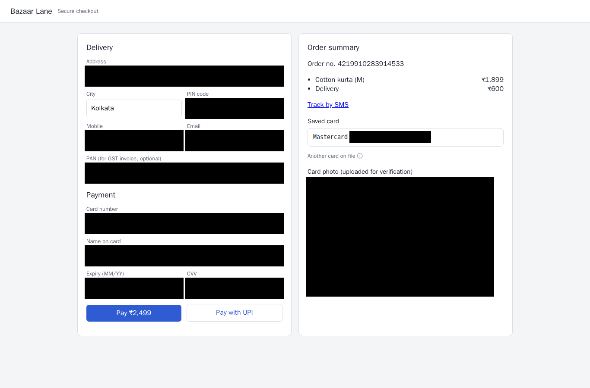

# PrivacyLens

**A local-first AI web agent that replaces sensitive data with bound placeholders before anything reaches an AI.**

PrivacyLens is an experimental web-agent privacy system. Local detection and sanitization are intended to keep sensitive values on-device; a vault releases a value only for its bound field and site. The project is being built in parallel across two worktrees, so several features below remain on branches and are not yet part of `main`.

## Status at a glance

| Component | Status | Evidence |
|---|---|---|
| Build foundation, contracts, IPC libraries, compose policy | Merged and tested | PRs #1 and #3 merged; PR #3 CI passed. The recorded local run reports 132 Python tests, 64 C++ tests under GCC and ASan/UBSan, and 27 compose-policy tests passing. |
| Detection and sanitization | Merged in PR #7; locally tested | 16/16 focused C++ tests passed in this session. |
| Synthetic ML/scenario generation | Merged in PR #7; locally tested | Python suites passed in this session; WIN status reports 131 ML tests plus a browser test and 87 scenario tests plus 13 browser tests. |
| Agent policy logic | Partial; merged in PR #7 | Python suites passed in this session; WIN status reports 180+ tests and 52/52 malicious replay actions stopped. IPC daemon wiring remains incomplete. |
| Vault, gate, and core runtime | Partial on `lnx/s1-platform` | Core runtime compiles; 87/87 C++ tests reported. The branch still has 26 clang-tidy findings and is not merged or containerized. |
| Ledger | Merged and tested | PRs #4 and #5 merged; PR #5 CI passed. The ledger reports 25 tests, including Merkle proof and tamper cases. |
| Dashboard | Partial | V1 merged in PR #4 and verified in labelled mock mode. The audit/posture/training additions on `win/winb-s2-dash` report 9/9 tests, but browser smoke failed and the real gate stream is untested. |
| Five-page data pipeline demo | Merged in PR #7; run passed | `make demo-pipeline` completed for all five pages with no failing pages. This is a Python demonstration, not the production C++/daemon pipeline. |

## Data pipeline demo

The demo renders five synthetic scenario pages in headless Chromium, detects and replaces values, blacks out image/canvas regions, and checks for leaks and vault-binding failures.

| Page | Planted | Detected | Placeholders | Leak check | Pixel check | Vault binding |
|---|---:|---:|---:|---|---|---|
| Login | 8 | 8 (+ 0 image/canvas) | 8 | 0 leaks | All covered | 9 sealed; correct binding opens; 5 wrong bindings refused |
| Checkout | 15 | 13 (+ 2 image/canvas) | 13 | 0 leaks | All covered | 13 sealed; correct binding opens; 5 wrong bindings refused |
| Support | 12 | 9 (+ 3 image/canvas) | 10 | 0 leaks | All covered | 15 sealed; correct binding opens; 5 wrong bindings refused |
| Video call | 10 | 7 (+ 3 image/canvas) | 7 | 0 leaks | All covered | 7 sealed; correct binding opens; 5 wrong bindings refused |
| Developer settings | 10 | 10 (+ 0 image/canvas) | 9 | 0 leaks | All covered | 10 sealed; correct binding opens; 5 wrong bindings refused |

Totals: 55 planted values, 47 text detections, 8 image/canvas regions blacked out, 47 placeholders, and 0 leaks. The checkout screenshot shows the sanitized view:

The demo uses Python validators and a synthetic-name dictionary; it does not call the production C++ detector or daemon stack. Image/canvas regions are blacked out whole because OCR is not yet integrated. The vault check exercises binding behavior, not the production daemon.

## Measured results

- Fourier scroll tracking: maximum 0.12 px error on random sub-pixel shifts; 3.0 ms p50 and 3.8 ms p99 on 480×270.
- Fuzzy search over 200,000 characters: 101 ms p50.
- Redaction pixel checker: solid fills pass; tested blur, pixelation, and visible text are rejected.
- DCT denoising did **not** meet the stated 40% error-reduction target on the measured pages (11–34%); text remained preserved.
- Local test counts above come from the worktree status reports; they are not all runs on `main`.

## Branches with unmerged work

| Branch | Contents and current limits |
|---|---|
| `lnx/s1-platform` | Vault, gate, and core runtime; partial, with clang-tidy findings and container/e2e work outstanding. |
| `win/winb-s2-dash` | Dashboard audit, isolation, posture, and training screens; 9 tests pass, but browser smoke is not passing and real-stream verification is pending. |
| `win/early-agent`, `win/early-p2`, `win/p0-early` | Earlier agent, ML, and scenario work; superseded/stacked work, not merged. |
| `user/add-fourier` | Fourier reference work. |

No `showcase` or `ui-prototype` remote branch was present when this README was prepared.

## Running checks

- On the current merged base: `make test-cpp-lnx` (80/80 passed in this session).
- On the current merged base: `make demo-pipeline` (five pages; no failing pages).
- In the dashboard worktree: `make -f Makefile -f dashboard/dashboard.mk dashboard dashboard-test` (9/9 reported by WIN-B; browser smoke remains unverified).

Use the corresponding worktree/branch for branch-only targets; they are not all available on `main`.

## Honest limits

PrivacyLens is not yet a complete, production-ready web agent. The detector/vault/gate/agent pipeline is not fully wired together in running containers, there is no verified live-gate end-to-end run, and the dashboard's live stream is not validated. OCR for images and canvases is missing; the demo blacks those regions out. Synthetic-name recognition is not general NER. Prompt Guard artifact access is pending license acceptance. The agent's tested policy modules are not yet a fully wired IPC daemon. See the status files and feature spec for the remaining work.
