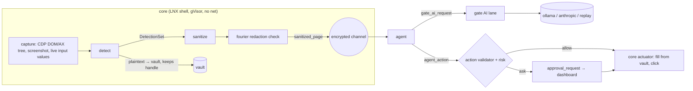

# WIN architecture (draft)

Status: **draft from the Phase 0 early start**. It was written before LNX's contract conventions (`contracts/README.md`), the `page_snapshot` schema and the `L-001` C++ API proposal existed. Every schema below is a field proposal, not a contract. The real schemas are written in WIN Phase 0 step 6, after LNX's conventions land, and this file will be updated to match.

WIN builds the "intelligence" half of PrivacyLens: finding sensitive data (`detect`), hiding it (`sanitize`), the Fourier helpers (`fourier`), the AI agent (`agent`), the scenario and red-team pages, all training (`ml/`) and the evaluation that proves it (`eval/`).

## 1. Components

| Component | Path | Kind | Runs in | Phase |
|---|---|---|---|---|
| detect | `daemons/core/detect/` | C++20 library linked into LNX's `core` | `core` (gVisor, no network) | P1 basic, P2 depth, P3 fusion |
| sanitize | `daemons/core/sanitize/` | C++20 library linked into `core` | `core` | P1, P2 |
| fourier | `daemons/core/fourier/` | C++20 library (FFTs via pocketfft/FFTW) | `core` | P2 |
| agent | `daemons/agent/` | Python daemon, `network_mode: none` | own container | P1, P4 |
| scenario pages | `scenarios/` | static HTML/CSS/JS + Python builder | `sites` container (internal `web` network) | P0, P2 red-team |
| ML | `ml/` | Python (uv): generators, training, tools | dev image / GPU host, never in the appliance | P0 onwards |
| eval | `eval/` | Python (uv) | trusted zone, `make eval` | P6 |
| scenario e2e | `tests/e2e/scenarios/` | pytest, run by LNX's harness | host + stack | P1 onwards |

Nothing WIN ships into the appliance has network access. Models come in as read-only mounted artifacts (AD-08) and are part of the attestation chain.

## 2. Data flow



- `detect` never stores plaintext past hand-off: on detection the value goes to the vault and `detect` keeps only an opaque handle bound to (session, placeholder, type, site, element) (AD-12).
- `sanitize` sees types, boxes and handles, never needs the value itself.
- `agent` only ever sees `sanitized_page` and returns actions that may name placeholders, never values.

## 3. Detection pipeline (`detect`)

Input: LNX's `PageSnapshot` (DOM + accessibility tree + boxes + live input values + screenshot). Output: `DetectionSet`.

Stages, in order. Each stage adds *evidence*. Scores are combined at the end.

1. **Text clean-up** (P1): NFKC, a confusables map (full-width digits, Cyrillic/Greek look-alikes), and removal of invisible characters (U+200B–U+200F, U+2060, U+FEFF, soft hyphen). Then **re-join by geometry**: adjacent text boxes on the same line (R-tree over the snapshot boxes, gap below about one character width) are joined into virtual strings. A virtual string maps every character back to its source node and box, so a detection on `<span>4111</span><span>1111</span>…` covers all the spans.
2. **Channel enumeration** (P1): every place text can hide is scanned as its own "channel" with a back-reference to the element: text nodes, input values (live, from capture), hidden inputs, `aria-label`/`aria-description`, `title`, `alt`, `placeholder`, `data-*`, URLs (href/src/action, decoded query), document title. This is the same channel list the scenario ground truth uses (§7).
3. **Pattern scan** (P1): one Vectorscan database for every format in spec §4, run over every channel's normalized text. Candidates then go through **validators**: Luhn + IIN ranges, Verhoeff + first digit 2–9, PAN structure (4th char holder type), IFSC (`AAAA0XXXXXX`), UPI (dotless provider), email, phone (IN + E.164), IPv4/6, PIN, passport, DOB, key prefixes (`sk-`, `ghp_`, `AKIA`, JWT), bank account (context-required), OTP (only with an OTP field signal).
   - **Overlap resolution:** the early-start tests found that about 1 in 10 strings like `+91 <mobile>` contain a 12-digit run that passes Verhoeff (an Aadhaar look-alike). Resolution rule: when candidates overlap, the one with the more specific context wins (phone prefix and separators, labels). Both still count as evidence for the fusion model, and the redaction covers the union of the spans either way, so this changes the label, never what gets hidden.
4. **Structural detection** (P1): `type=password` (including show-password toggles that flip it to `text`), `autocomplete` tokens (`cc-number`, `cc-csc`, `one-time-code`, `street-address`, `postal-code`, …), ARIA roles, nearby labels (CVV, OTP, PAN…), chat-message containers (`role=log`, message-list shapes).
5. **Image/canvas/video** (P2): OCR only on pixels that have no DOM text (images, canvas, video), using RapidOCR, with noisy-channel correction (confusion-weighted candidate search; if any plausible reading passes a check digit, redact). Faces: YuNet/SCRFD + Kalman + Hungarian + persistence + whole-tile lock.
6. **Contextual + unknown secrets** (P2): GLiNER (names, addresses, medical), character 5-gram Kneser–Ney + entropy/compression/NIST spectral for unknown keys, Sinkhorn label-to-field matching, spectral page blocks, quasi-identifiers per block.
7. **Fusion** (P3): Dawid–Skene label model → LightGBM (C API) over all evidence → **conformal threshold** per type (α = 1 % default). SHAP contributions become the explanation ("CARD 0.97: Luhn +3.0, label 'Card number' +1.2 …").
8. **Taint** (P2): each detection gets a taint label from LNX's lattice. Anything overlapping or derived from a detection gets the join.

Performance: incremental by node ID + keyed content hash (detection cache, P2) and phase-correlation scroll tracking (P2). Per-stage p50/p99 recorded in `docs/status/win.md`.

## 4. Sanitization (`sanitize`)

- Placeholders `[REDACTED:TYPE#n]`, fixed length per type, `n` random per session (P1).
- Solid-fill boxes over the **field** box plus margin. Text boxes are rounded up to fixed widths so length doesn't leak. PNG re-encode with metadata stripped (P1).
- Scrub every channel from §3.2 (URL + query, title, aria-*, tooltips, placeholder, `data-*`, alt, image metadata) (P1).
- Fourier redaction checker on every outgoing frame: a box that isn't truly flat blocks the frame (P2).
- Adaptive redaction (safe attributes like "filled: yes"), policy-controlled (P2). Smart context keeping under the privacy budget (P4).

## 5. Agent loop (`agent`)

```
loop:
  page   ← recv sanitized_page (validated against schema)
  prompt ← [system fence][user task fence][webpage fence: UNTRUSTED, sanitized AX tree + redacted screenshot]
  reply  ← gate AI lane (constrained decoding: Ollama `format` = agent_action JSON schema)
  action ← re-validate schema → output PII scan (block) → action validator → hard rule → risk score
  if risk = deny: record decision, re-prompt with a refusal note
  if risk = ask or irreversible: approval_request → wait for signed approval_token (timeout = deny)
  send action to core (fill values are placeholders only; core resolves them through the vault)
```

- **Action validator**: target node exists and is visible in the *current* snapshot; no `javascript:`/`data:` URLs; navigation only to the task's allowed domains; no coordinate clicks.
- **Anti-reconstruction**: a sensitive field accepts only the placeholder of its own type and binding; there is no "read field" action; model output is scanned with the detect patterns (any hit ⇒ block); the system prompt forbids guessing; no partial hints anywhere.
- **Hard rule**: every action carries a `justification` with provenance spans. If all of them point into the webpage fence, the action is blocked.
- **Risk** (noisy-OR): `1 − Π(1 − w_i·f_i)` over irreversible, uses-sensitive-value, new-domain, goal-distance and (P4) injection score and GW alarm. Allow/ask/deny thresholds live in the policy.

## 6. ML plan

| Phase | What | Where | Output |
|---|---|---|---|
| P0 | Value generators + validators (`ml/gen/values.py`) | CPU | code (done in early start) |
| P0 | Snapshot recorder (`ml/tools/record_snapshot.py`) | headless Chrome | `scenarios/fixtures/*` |
| P2 | Synthetic page generator v1: layout families × channels × value formats, rendered in Chrome | CPU | gitignored pages + labels |
| P3 | Ollama-written surrounding text (EN/HI/Hinglish), thousands of pages, Parquet, splits **by layout family** | GPU (8 GB) | `ml/data/` (gitignored) |
| P3 | Label model + LightGBM fusion + conformal thresholds + optional GLiNER fine-tune | CPU/GPU | Release `models-vN` |
| P4 | Injection classifier, evolved attacks (MAP-Elites), RAG index, GW library | GPU | Release assets |

Overfitting guards (tested): no layout family in two splits; the five scenario pages are never in training; real public pages are used only as unlabeled feature sources.

Third-party models are pinned in `ml/artifacts.lock.json` by source URL, revision, SHA-256 and license, and never re-published. Our own trained artifacts are GitHub Release assets. Both are fetched by `ml/tools/fetch_artifacts.py` (later `make fetch-artifacts`) and attested by LNX's chain. Chosen in the early-P2 work (draft lock):

| Use | Model (pinned revision in the lock) | License | Size | Notes |
|---|---|---|---|---|
| GLiNER PII spans | `onnx-community/gliner_multi_pii-v1` int8 ONNX (upstream `urchade/gliner_multi_pii-v1`) | Apache-2.0 | 370 MB | multilingual backbone, so Hindi script works; fallback `knowledgator/gliner-pii-base-v1.0` (English, official ONNX) |
| OCR | RapidOCR hub `SWHL/RapidOCR`: PP-OCRv4 det + rec, PP-OCRv3 English rec, v2 angle cls | Apache-2.0 | 25 MB | Latin + digits; no Devanagari recogniser there |
| Faces | `opencv/face_detection_yunet` 2023mar | MIT | 0.2 MB | SCRFD rejected: non-commercial weights |
| Prompt injection | `meta-llama/Llama-Prompt-Guard-2-86M` | Llama 4 Community License (gated) | 1.1 GB | no official ONNX; export in P4 |
| Embeddings | `intfloat/multilingual-e5-small` ONNX | MIT | 490 MB | EN/HI/Hinglish; the repo's int8 file needs AVX-512 VNNI, which this CPU lacks |

## 7. Scenario pages and ground truth (built in the early start)

- Templates in `scenarios/pages/<name>/`, filled by `python -m plscen.build --seed N`. Output: `build/site/<name>/` (served) and `build/truth/<name>.json` (**never served**). All of it is gitignored and reproducible from the seed.
- Fictional brands only: Saffron Bank (login), Bazaar Lane (checkout), Kestrel Telecom (support), Orbit Meet (video), Nimbus Cloud (developer settings).
- **Channel vocabulary** (shared by ground truth and detect): `input_value`, `input_hidden`, `text`, `text_split`, `attribute` (+ `attribute` name), `url_query` (+ attribute), `image`, `canvas`. Obfuscations so far: `zero_width`, `fullwidth_digits`.
- **Ground-truth item** (draft, eval-only file in the trusted zone, not a contract message): `id, type, value, shown, selector, channel, attribute?, obfuscation[], canary, box?, motion?, asset?`, plus page-level `decoys[]` (look-alikes that must *not* be redacted) and `canaries[]`. Render-time bounding boxes for DOM items are added by the snapshot recorder (step 5).
- **Canary formats (proposal; needs LNX's agreement because the gate checks them):**
  1. *Self-checking token:* `PLCANARY-<16 Crockford base32>-<2-digit check>`, where the check is the base-32 value mod 97. The gate can recognise these with a regex and no list.
  2. *Format-valued canaries* (cards, Aadhaar, keys): ordinary generated values, indistinguishable from real data by design, listed in the page's `canaries[]`. The gate gets the list as a canary registry. Registry format and how it reaches the gate is an open question for LNX.

## 8. Proposed schema fields (WIN is the producer)

General rules followed: metadata only; none of the banned names (`value`, `raw`, `text_raw`, `secret`, `plaintext`); no hashes of individual values (spec §11). IDs are opaque. Versions follow LNX's conventions once they exist.

### `detection` (one per finding; `DetectionSet` = list + snapshot id)
| Field | Type | Notes |
|---|---|---|
| `detection_id` | string | opaque, per session |
| `snapshot_id` | string | LNX `page_snapshot` id |
| `data_type` | enum | `card`, `aadhaar`, `pan`, `ifsc`, `upi`, `email`, `phone`, `dob`, `api_key`, `password`, `otp`, `name`, `address`, `face`, … |
| `node_id` | string | DOM/AX node (or canvas/image node) |
| `channel` | enum | §7 vocabulary |
| `attribute` | string? | for `attribute` / `url_query` |
| `span` | {start, length}? | char offsets in the normalized channel text (P1); no characters |
| `boxes` | [[x,y,w,h]] | page coordinates |
| `evidence` | [{kind, rule_id?, weight}] | e.g. `luhn`, `iin`, `label:cvv`, `autocomplete:cc-number` |
| `score` | number [0,1] | fused; P1 = rule score |
| `taint` | LNX `taint_label` | |
| `vault_handle` | string | opaque handle from the vault (AD-12) |
| `placeholder` | string | `[REDACTED:CARD#3]` |
| `rule_id` | string | `D-xx` that fired |

### `sanitized_page`
| Field | Type | Notes |
|---|---|---|
| `snapshot_id`, `session_id`, `seq` | | |
| `url_redacted` | string | origin + path, query values replaced by placeholders |
| `title_redacted` | string | |
| `ax_tree` | [{node_id, role, name_redacted, state, bounds, children}] | names/labels with placeholders substituted |
| `fields` | [{node_id, kind, placeholder?, filled: bool?, data_type?}] | adaptive-redaction facts only |
| `screenshot` | {format: png, width, height, ref} | redacted image; `ref` points to the frame on the channel |
| `redactions` | [{detection_id, placeholder, box}] | |
| `checks` | {fourier_flat: bool, scrubbed_channels: [..]} | for audit |

### `agent_action`
| Field | Type | Notes |
|---|---|---|
| `action_id`, `session_id`, `snapshot_id` | | the snapshot it was planned on |
| `kind` | enum | `click`, `fill`, `select`, `navigate`, `scroll`, `done` |
| `target_node_id` | string? | required except `navigate`/`done`/page `scroll` |
| `fill_placeholder` | string? | `fill` only, must match `^\[REDACTED:[A-Z_]+#[0-9]+\]$` or be a non-sensitive literal from a policy allow-list (e.g. quantity) |
| `option` | string? | `select` |
| `url` | string? | `navigate`; http(s) only |
| `direction`, `amount` | ? | `scroll` |
| `justification` | [{source: system/user/webpage, span_ref}] | for the hard rule |
| `irreversible` | bool | set by the validator, not trusted from the model |

### `approval_request`
| Field | Type | Notes |
|---|---|---|
| `request_id`, `session_id`, `action_id` | | |
| `action_summary` | string | built from types, placeholders and element names only |
| `risk` | number | noisy-OR total |
| `factors` | [{name, weight, value}] | e.g. `irreversible`, `new_domain` |
| `rule_ids` | [string] | `A-xx` |
| `nonce`, `expires_at` | | the dashboard's `approval_token` binds to these + a hash of the canonical action |
| `timeout_ms` | int | timeout = deny |

### `policy` (signed `policy.yaml`, validated as JSON)
| Field | Type | Notes |
|---|---|---|
| `version`, `issued_at`, `signer_key_id`, `signature` | | verified with LNX's signing library; unsigned ⇒ refuse |
| `rules` | [{id: `^(D|E|A|I|U)-[0-9]{2,3}$`, kind, match, effect, params, description}] | every decision names one |
| `thresholds` | {risk_allow, risk_ask, conformal_alpha, privacy_budget} | |
| `safe_attributes` | [string] | adaptive redaction |
| `allowed_domains` | per task | |

## 9. How WIN outputs reach the attestation chain

The C++ libraries are part of the `core` image digest. The agent image is its own digest. Models and thresholds are listed with SHA-256 in `ml/artifacts.lock.json`, which LNX's attestation includes (request to LNX in P2/P3). The policy file is signed and its hash recorded at load. Eval results reference the attestation value of the run that produced them.

## 10. Open questions for LNX (to become requests in Phase 0)

1. `L-001` C++ API: adopt or amend once the proposal header exists. WIN wants `DetectContext` to carry the session placeholder RNG and the vault hand-off callback, so `detect` never returns plaintext to the shell.
2. `page_snapshot`: needs live input values, per-node boxes, AX names/descriptions, all attributes (for `data-*`), the URL, and canvas/image pixel references.
3. Canary registry: format and delivery to the gate (§7).
4. `sites` service: WIN's `scenarios/compose.yml` fragment on the internal `web` network. It serves `build/site/` read-only and never `build/truth/`.
5. Dev image: WIN's render test needs headless Chromium + Playwright 1.52 (or CDP-only via the Chrome LNX ships for `core`). Python packages so far: pytest, hypothesis, pytest-cov, mypy, ruff, beautifulsoup4, pillow.
