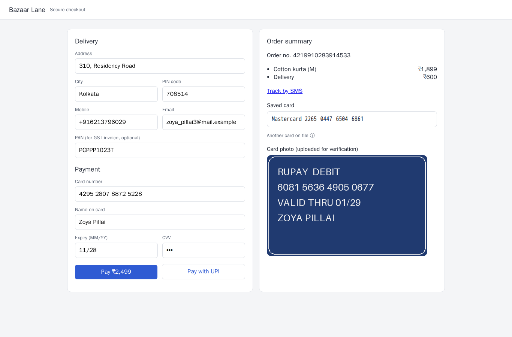
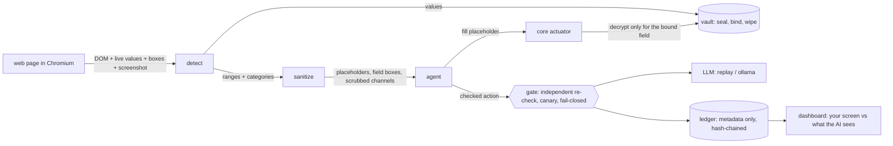

# PrivacyLens: what we built (WIN part)

*Honest status as of the sprint, written for the README. "Built and run" means we ran it and read the output;
"built, unmerged" means code and tests exist on a branch; "planned" means not built. Numbers are measured,
including the ones that missed the spec.*

## The idea in one paragraph

An AI agent can use websites for you without your private data ever reaching the AI company. Everything
sensitive is found and replaced **on your machine**; the AI sees `[REDACTED:CARD#4821]`, never the value.
When the agent says "fill the card field with `[REDACTED:CARD#4821]`", a separate **vault** decrypts the real
value, but only for that exact field on that exact site, and the browser process types it locally.

## Data pipeline demo (run it: `make demo-pipeline`)

Five scenario pages (login, checkout, support chat, video call, developer settings) are rendered in headless
Chromium, captured with live input values, detected, sanitized, vaulted and checked. Open
`scenarios/build/demo/index.html` for the **3D data-flow view** (three.js: your screen, the detector, the
sanitizer gate, the vault, and what the AI sees) and per-page before/after pages.

| page | values planted | detected | placeholders issued | leak check (values + encodings) | pixel check (planted values under solid black) | vault binding test | decoys kept (must stay visible) |
|---|---|---|---|---|---|---|---|
| login | 8 | 8 + 0 image/canvas (fail-closed) | 8 | 0 leaks | all covered | 9 sealed; right binding opens, 5 wrong bindings refused | 0/0 |
| checkout | 15 | 13 + 2 image/canvas (fail-closed) | 13 | 0 leaks | all covered | 13 sealed; right binding opens, 5 wrong bindings refused | 1/1 |
| support | 12 | 9 + 3 image/canvas (fail-closed) | 10 | 0 leaks | all covered | 15 sealed; right binding opens, 5 wrong bindings refused | 0/0 |
| video | 10 | 7 + 3 image/canvas (fail-closed) | 7 | 0 leaks | all covered | 7 sealed; right binding opens, 5 wrong bindings refused | 0/0 |
| devsettings | 10 | 10 + 0 image/canvas (fail-closed) | 9 | 0 leaks | all covered | 10 sealed; right binding opens, 5 wrong bindings refused | 0/0 |

Totals: 55 planted, 47 detected by the detector, 8 inside images/canvas (blacked out), 0 leaked, 47 placeholders issued.

What this proves, and what it doesn't:
- **Leak check:** every planted value, as rendered and canonical, in 9 encodings (as is, case-folded,
  look-alikes removed, separators removed, base64, base64url, hex, URL-encoded, reversed digits), searched in
  everything the AI would receive. The same scan finds the values in the original capture (control).
- **Pixel check (independent of the string check):** every planted value that is visible on screen sits under
  solid black in the redacted screenshot. This caught a real bug: our name detector redacted only the surname of
  "First Last", and the string leak check could not see it.
- **Vault binding:** each value is sealed with XChaCha20-Poly1305, associated data
  `session | placeholder | field type | site | element`. The right binding opens; a wrong field, wrong site,
  wrong type, wrong placeholder or wrong session is refused (5 wrong bindings per value, all refused).
- **Decoys stay visible:** a 16-digit order number that fails Luhn is not redacted.
- **Limits, stated plainly:** this run's detector is the Python validator set (the C++ detect library exists and
  passes its tests, but this demo does not call it). Name detection is a dictionary of the generator's synthetic
  names: a stand-in that only works on synthetic data (GLiNER is Sprint 2). Images and canvases (card photo,
  cheque, screen share, avatars) are blacked out whole because there is no OCR yet. The vault here is a
  demonstration of the binding; the real one is `daemons/vault`.

## The pipeline, end to end

| Stage | What it does | Status |
|---|---|---|
| Capture | DOM snapshot with live input values, every attribute, own text, boxes, screenshot | built and run (demo, Playwright/Chromium); the production CDP pipe client is LNX's `daemons/core/runtime` (written, not yet compiled) |
| Detect | Unicode clean-up, check-digit validators, multi-pattern scan, structural rules, split-value re-join | built and run (C++ library, 16+ tests, ASan/UBSan clean; Python twin in the demo) |
| Sanitize | placeholders, solid **field** boxes, PNG re-encode, scrub URL/title/aria/alt/placeholder/data-* | built and run (C++ library + demo) |
| Vault | AEAD with binding, decrypt only for the exact field, wipe | demo built and run; `daemons/vault` (C++, `memfd_secret` master key) built with tests, **unmerged** |
| Agent | strict action schema, validator, anti-reconstruction, provenance fences, noisy-OR risk, replay | logic built and tested (180+ tests; 52-step malicious replay set: 0 execute); IPC daemon not wired yet |
| Gate | fail-closed AI lane, independent re-check, canary check, egress record, browsing lane | `daemons/gate` built with 14 tests, **unmerged**, not yet run in containers |
| Ledger | metadata-only event bus, hash-chained append-only segments, rejects value-like fields and canaries | built, tested (ASan/UBSan), **merged** (PR #4) |
| Dashboard | your screen vs what the AI sees, approvals (timeout = deny), kill switch | v1 merged, mock mode clearly labelled; real stream wiring in progress |

### Daemons (programs that run as their own process)

Yes: at least one is real and merged. **`ledgerd`** (`daemons/ledger`, merged in PR #4) listens on a Unix socket,
rejects any message with a value-like field or a planted canary, appends accepted records to hash-chained
segments, serves a stream endpoint, and verifies its own chain (`ledgerd --verify`). It was run by hand: a valid
event was acknowledged, an event carrying a `raw` field was rejected with rule LG-001, and verification
printed OK. **`pl-vault`** and **`pl-gate`** are built with unit tests (8 and 14) on branch `lnx/s1-platform`
and are not merged or containerised yet; the **core runtime** daemon is written but has not compiled yet. The
agent is a set of tested modules, not yet a daemon.

## Algorithms and mathematics (what is implemented, tested and measured)

**Check digits and structure**
- **Luhn** (mod 10) with public issuer ranges (IIN). Property tests: every single-digit error is caught, and every
  adjacent swap except 09/90.
- **Verhoeff** for Aadhaar: the dihedral group D5 with a position permutation. The table implementation is checked
  against an independent from-first-principles construction (group law + permutation) on random inputs; it catches
  every single-digit error and every adjacent transposition.
- **PAN** structure (holder-type letter), **IFSC**, **UPI**, API-key prefixes, JWT shape.
- **Self-checking canaries** `PLCANARY-<16 Crockford base32>-<NN>`, NN = (base-32 value) mod 97, so the gate can
  recognise a planted secret without a list.

**Text and geometry**
- **Unicode normalisation with a source-offset map**: NFKC, Cyrillic/Greek look-alikes, native digits, removal of
  zero-width and bidi characters; detections are reported against the *original* string, so exactly what is on the
  page gets replaced.
- **Split values re-joined by on-screen geometry** (spans on one line with a small gap), so
  `41111111…` is found as one card.
- **Fixed-width boxes**: redaction boxes cover the field and are rounded up to 32 px steps, so the box does not
  reveal the length of the value.

**Cryptography**
- **XChaCha20-Poly1305 AEAD** with the binding as associated data; a wrong binding means authentication failure.
- **Taint lattice** (level chain × set of data categories, join = (max, union)); only "public" may leave.
- **Hash-chained segments** in the ledger (Merkle tree with signed roots is Sprint 2).

**Fourier techniques** (Python reference `ml/reference/pl_fourier.py`, measured by `bench_fourier.py`)

| Technique | Math | Measured |
|---|---|---|
| Scroll tracking | phase correlation: inverse FFT of the normalised cross-power spectrum, Hann window, 3-point parabola for sub-pixel | worst error 0.12 px, 3 ms on 480×270 |
| Redaction checker | a solid fill has only a DC term; leftover energy fails; edge energy folded on the best regular grid separates pixelation from blur | solid passes; blur, pixelation, text (even 3/255 ink) fail with a reason |
| Fuzzy secret search | per-character FFT correlation counts mismatches at every offset in O(n log n); masked characters count as matches | 200 000 characters in about 0.1 s |
| Perturbation detector | spectral flatness (Wiener entropy); white noise ≈ e^-γ ≈ 0.56 | clean pages 0/20 flagged; noise ≥ 1/255 flagged 20/20 |
| DCT denoiser | 8×8 orthonormal DCT, hard threshold at 2σ̂ with σ̂ from noise-flat blocks | **17–34 % error reduction, below the spec's 40 %**; text preserved (IoU ≥ 0.987) |
| Randomness | NIST SP 800-22 spectral test (erfc of the normalised peak count) | weak on strings; the NIST document's own worked examples disagree with its steps (recorded) |

**Decision math**
- **Noisy-OR risk**: risk = 1 − Π(1 − wᵢ·fᵢ) over irreversible, sensitive value, new domain, goal distance and
  attack alarm. Property tests: bounded in [0,1], at least the largest term, at most the union bound,
  monotone, order-independent. Irreversible actions never auto-run.
- **Provenance hard rule**: an effectful action needs a *verified* user quote (the quote must occur in the user's
  task). Page text relabelled as "user" is downgraded.

**Planned, not built yet** (Sprint 2 in the plan): Dawid–Skene label model, LightGBM fusion with conformal
thresholds and Saabas attributions, Sinkhorn label-to-field matching, spectral page clustering, the C++ Fourier
port, an injection classifier, Merkle audit proofs, attestation chain, OCR, face tracking.

## What makes it different (USP)

1. **The AI never holds the secret.** Placeholders go to the model; the vault decrypts only for the exact field
   and site, and only the actuator types it. Binding is cryptographic (AEAD associated data), not a rule in code.
2. **Defence in depth with independent checks.** The agent has its own PII scanner, the gate has a separately
   written re-check (it may not import detect's code), and the ledger rejects value-like fields. A bug in one is
   not a leak.
3. **We test the redaction, not just the detector.** String leak scan over nine encodings *and* an independent
   pixel check; the pixel check found a bug the string check could not.
4. **Adversarial input is the default.** Look-alike and invisible characters, split spans, values in aria-labels,
   alt text, URLs and data-* attributes, base64/hex/URL-encoded secrets, hidden text, prompt injections in English,
   Hindi and Hinglish; page text is fenced and labelled untrusted, and an injection-justified action is blocked.
5. **Fail closed.** Unscanned images are blacked out whole, a failed vault call still removes the text, an
   exhausted replay or any agent error ends the run, the gate blocks on doubt.
6. **Honest numbers.** We report what we measured, including misses (DCT 17–34 %, not 40 %; NIST example
   inconsistency; the hard rule can be laundered by quoting the task) and label stand-ins as stand-ins.
7. **Reproducible.** Seeded generators and page builders; same seed, same bytes; no real PII anywhere (valid
   check digits, reserved example domains, documentation IP ranges).
8. **Tamper-evident record.** Metadata-only ledger with hash-chained segments (Merkle proofs next).
